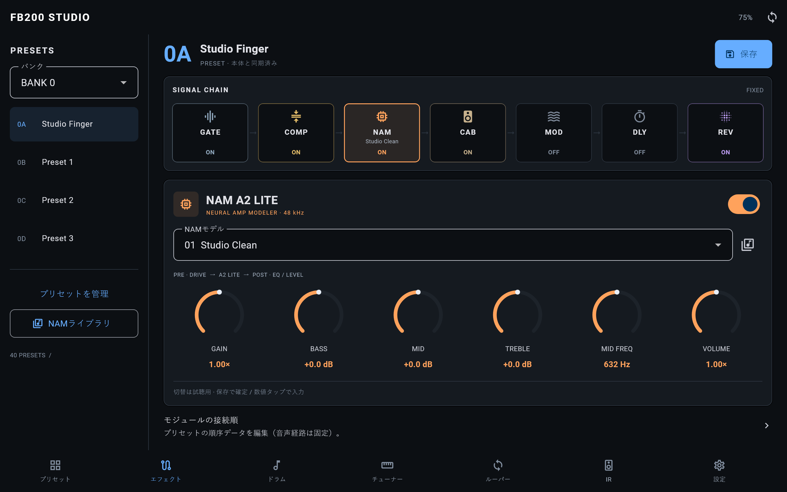

# FB200 NAM Studio — 0.10.0+14

最新版：操作設計と本体AMPノブ対応は [0.10.2の実装・検証記録](NAM_STUDIO_UX.md) を参照。

`feat/nam-a2-lite-studio`（基点：`fix/nam-windows-usb-audio`）のAndroid / Flutter UI。

[スマートフォン縦画面](fb200-studio-phone-v1.png)

画像は画像生成によるモックアップではなく、Flutterの実装画面をメモリ内の模擬ペダルに接続して描画したものです。実機の接続・音声動作を示すものではありません。

## 音作りの流れ

1. Bluetoothで接続し、「コントローラー」を開く。NAMブロックが初期選択される。
2. モデル欄から本体内のA2 Liteモデルを試聴切替。ライブラリアイコンからTONE3000 / .nam取込とスロット転送に進める。
3. GAINでモデルへの入力、BASS / MID / TREBLE / MID FREQでモデル後のEQ、VOLUMEで出力を調整。数値タップで直接入力できる。
4. 上部の「保存」でNAMモデルの紐付けとトーン値をプリセットにまとめて保存・照合する。切替だけではフラッシュに保存しない。

広い画面では現在のバンクの4プリセットを左に常設。狭い画面では下部のプリセットタブから切り替える。40プリセットの管理・バックアップ、IR、ドラム、チューナー、ルーパー、設定は維持している。

## NAMとファームウェア

既存の `nam_tone.c` が実行経路に接続されていなかったため、NAM音声経路に組み込んだ。GAINの前処理 → A2 Lite推論 → 3バンドEQ / VOLUMEの後処理とし、キャビネット後の独立した5バンドEQは維持する。

対応をcapability bit 9で通知。旧ファームウェアではGAIN / VOLUMEを使え、未対応のEQノブ4個は無効になる。全6ノブを音声に反映するには本ブランチの対応ファームウェアが必要。モデル重み・FBNM形式・転送の検証処理は変更していない。

現在のファームウェアの音声経路は固定。プリセットの順序メタデータを編集しても、その順序で処理されるとは表示しない。NAMブロック内のトーンEQはそのブロックに含む。

## 検証

2026-10-20の結果：Flutter 143件成功、format差分なし、analyze指摘なし、APKビルド成功。NAM RPC / ストレージ / DSPのホスト検証97件成功。最終DSP再検証とNAMプロファイルのARMビルド・配置検査16件成功（重複を含むため件数は合算しない）。

- Flutter 3.47.7 / Dart 3.13.5：format、analyze、Flutterテスト。
- 模擬接続：モデル試聴では保存しないこと、ノブの直接入力、モデル紐付けと値の保存・照合、バイパス、操作失敗、プリセット通知、ライブラリからの復帰、旧FWの制限。
- 360×640〜1280×800の縦・横レイアウト。上の画像は `flutter test tool/studio_preview.dart` で再生成できる。
- C DSPホストテスト：ニュートラル時の一致、ドライブとレベルの順序、ミュート、低域・高域シェルフ、MID周波数の移動、フラットに戻したときの履歴除去。
- ARMビルド：実メモリ制約と、音声・フラッシュ書込中のコード配置を検査。追加EQはコンパクトなDF2Tループを使用し、係数設計などのコールド処理をフラッシュへ配置。
- Android debug APKをビルド。実機へのFW書き込みとAPKファイル転送は下の導入記録を参照。アプリのインストール、実機BLEでのモデル転送、音の確認とCPU負荷実測は今回実施していない。

旧FWで無視されていたEQ値も新FWでは音声に反映されるため、既存プリセットの音が変わる可能性がある。ニュートラル値はGAIN/BASS/MID/TREBLE/VOLUMEが50（VOLUME 100は2倍）、MID FREQは任意。

## 実機導入（2026-10-20、ユーザーの明示指示）

- USB COM7のFB200に `nam-manager` アプリスロット214,692 Bを書き込み。`fw done crc=932f2aa7 ok`、リセット後のフラッシュCRCも一致。
- NAM capabilitiesは48 kHz / 1,871 weights / 64 slots / flags **1023**。トーンEQ対応bit 9が立っていることを確認。
- recovery、stock、user data、NAMモデル領域のCRCが更新前後で一致。40プリセットと設定の生データも一致。stockは `flash ok, in use`、`no crash dump`。
- Lenovo TB-J716Fの `/sdcard/Download/fb200-studio-0.10.0-14-debug.apk` へAPKを転送。端末上のSHA-256がPC側と一致。インストールは未実施。
- 導入ログ・スナップショットは `out/studio-deploy-20261020/`。FW SHA-256: `ecf59aa9cf3896a55bbd853ef099cf3ba9b4262d0a7e8c865acecf29f89835da`。
- この確認はFW起動・能力通知・保存データ保全とファイル転送の検証。実際のNAM音声・EQの試聴を確認したものではない。
