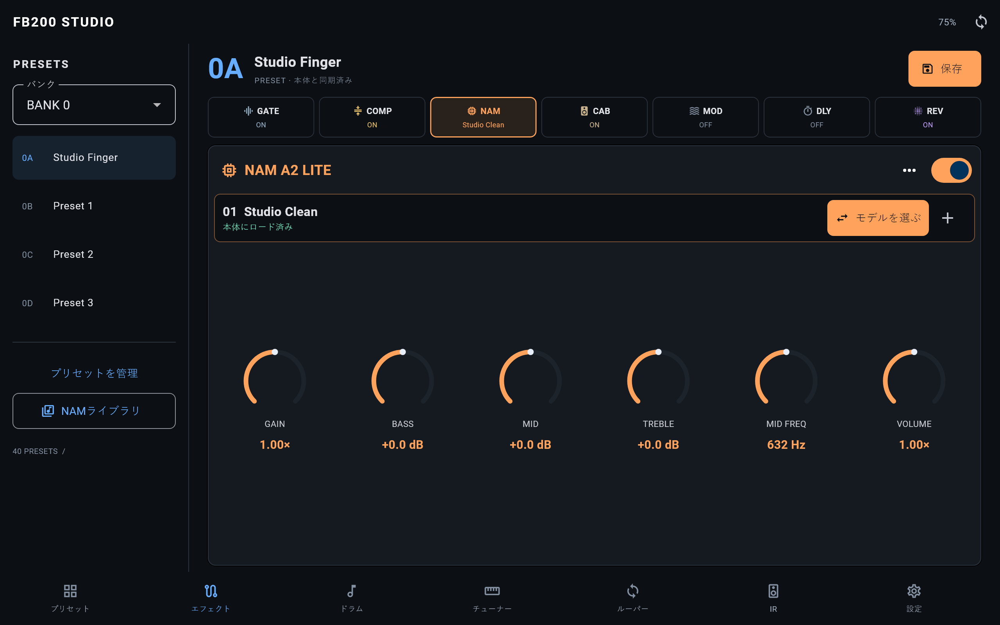
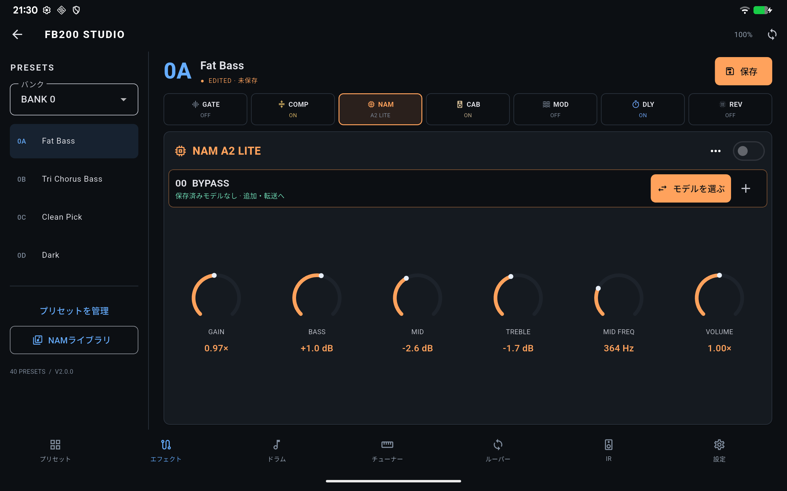

# メインパネルの固定配置 — 0.10.3+17

0.10.2では、カードを自然な高さで縦に積み、画面に収まらない部分をスクロールで
補っていた。そのため、実機タブレットでも操作説明や接続順データと一緒にノブや値が
画面外へ移動した。音作り画面を固定のコントロール面へ変更した。

- エディターはスクロール用ラッパーを通さず、表示領域の高さを直接使う。
- 信号経路はコンパクトな固定配置。大きな画面ではモデルとNAMの6ノブを同時表示。
- 小さな画面ではモジュールをメニューで選択し、収まらないパラメーターは
  「前／次」の明示的なページ切替で操作する。ノブを操作してパネル全体が移動しない。
- 接続順メタデータと操作説明は詳細メニューへ移動。
- 短い横画面ではプリセット名と保存をアプリバーにまとめ、調整領域を確保。
- プリセット一覧・IR・設定や、モデル検索シートは従来どおり必要な一覧をスクロールできる。

固定配置の回帰テストでは、360×640〜1280×800の7サイズに上下24 dpのシステム余白を
加え、エディター内にScrollableがないこと、ノブ全体が表示領域に収まること、
全6パラメーターへ到達できることを確認する。1000 dp以上の画面ではページ切替なしで
6ノブが同時表示されることも確認する。

プレビューは `flutter test tool/studio_preview.dart` で再生成できる。

[スマートフォンの固定配置](fb200-studio-phone-v3.png)

上の2枚は模擬ペダルを使った実装画面。

## 実機確認

Lenovo TB-J716F（2560×1600、density 320）へ0.10.3 / versionCode 17を
更新インストールし、FB200へBLE接続。モデル欄と6つのNAMノブ・値を同時に表示。
ノブ外の余白で上向き・下向きに縦スワイプし、それぞれ直後のアクセシビリティ情報を
初期状態と照合した。モデル欄・全6ノブの座標と値が移動・変更されないことを確認。
保存やプリセット切替は行わず、既存の編集中の状態を維持している。

Flutter解析指摘なし、全162テスト成功、プレビュー生成・Android APKビルド成功。
今回ファームウェアの変更・再書込は不要。APKはDownloadにも転送し、PCと端末の
SHA-256が一致。導入・スワイプ前後の証跡は`out/fixed-panel-20261021/`、
検証ログは`out/fixed-panel-*.log`。
