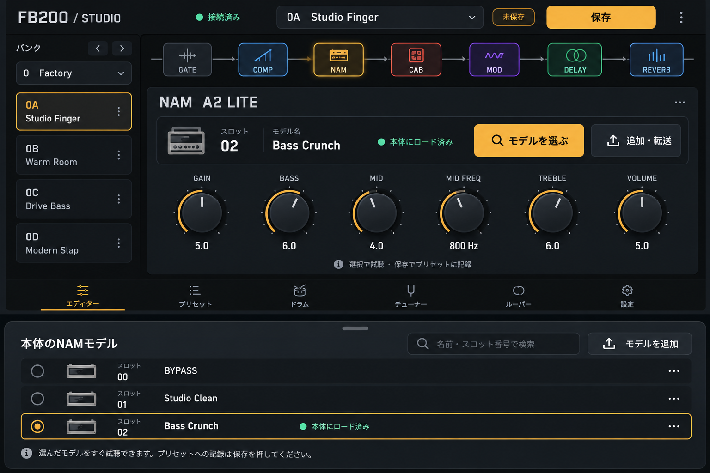
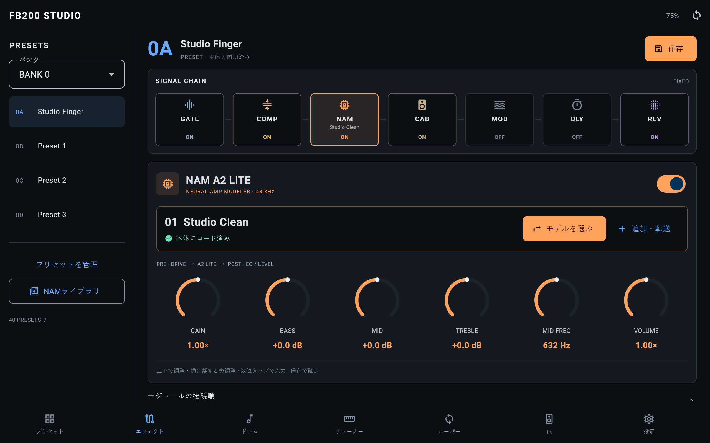

# FB200 Studio 操作設計 — 0.10.2+16

2026-10-21、`feat/nam-a2-lite-studio`。

## imagegenによる試作

組み込みimagegenで作成。[生成プロンプト全文](fb200-studio-ux-concept-v2-prompt.txt)。
画像は設計の検討用。画面をビットマップとして貼り付けず、Flutterの操作可能な
ウィジェットとして実装した。試作の装飾・架空の数値は採用せず、単位と値は実際の
NAMトーン処理に合わせた。

## 実装画面

[スマートフォン画面](fb200-studio-phone-v2.png) ·
[モデル選択シート](fb200-studio-model-picker-v2.png)

この3枚は実際のFlutterウィジェットを模擬ペダルに接続して描画したもの。
`flutter test tool/studio_preview.dart`で再生成できる。物理デバイス上の
音声・モデル転送が成功した証拠を表すものではない。

[Lenovo実機・FB200へのBLE接続後のコントローラー](fb200-studio-android-real-v2.png)
では実際の保存プリセットと空のNAMストアを表示している。モデル選択シートの
表示とキャンセルも実機で確認。テストモデルの転送やプリセット変更は行っていない。

## 操作と状態

- コントローラーはNAMを初期選択。モデル名・本体へのロード状態・大きな
  「モデルを選ぶ」「追加・転送」を同じカードに配置。広い画面では横並び。
- 「モデルを選ぶ」は本体内のモデルを検索するシートを開く。番号・名前で絞り込み、
  現在のモデルにチェック。00 BYPASSを常に扱え、空き・削除済みの選択もエラーにせず
  選び直せる。閉じるだけではモデルを変更しない。
- 選択は試聴。モデル紐付け・GAIN/EQ/LEVELをプリセットに記録する操作は
  アンバー色の「保存」。未保存のまま別プリセットへ移る際は既存の破棄確認を使う。
- ノブは上下ドラッグ。指を横に80 px以上離すと感度が1/4になり微調整できる。
  操作中の値を表示し、指を離して本体へ送る。キャンセルでは値を戻す。
  数値タップでプリセット値を直接入力でき、範囲外を明示し適用を無効化。
  NAMには「標準に戻す」も用意。通常のトーン変更に全面の待機ダイアログを出さない。
- モデル追加はTONE3000または.nam取込→「転送先を選ぶ」→転送→
  「ロードして試聴」。上書き確認を維持し、転送だけでは音色を変えない。
  進捗・中止・結果・エラーはライブラリ下部に固定し、64スロットの末尾へ埋もれさせない。
  空きスロットの大量表示は切替式。
- シートは小さい横画面やキーボード表示中に拡大し、補足を縮めて選択行を確保。
  プリセット選択・保存・モデル転送が同じBLE接続を共有する。

## 本体AMPノブ

NAMビルドではAMPノブ（k2）がBYPASSと有効な保存済みNAMを番号順に選ぶ。
たとえば保存が2と64だけなら、回転範囲は0・2・64の3区分。空き・壊れたモデル・
削除マーカーは除外する。純正プロファイルのAMP 1〜10は従来通り。

ノブが止まって250 ms後にロード。素早い回転中はロードを連発しない。
表示は`n00`（BYPASS）または`n02`等の実スロット番号。末尾の点はノブ位置の
追従待ち／選択確定待ち、`bUS`はスロット走査・転送中、`Err`はロード失敗。
別プリセットやアプリで選んだ値に追いつくまで、物理ノブは音を変えない。
狭い選択区分を一度に飛び越した場合も追従を検出する。

モデル一覧は10 msごとに1スロットずつ検証して保持し、転送・削除・失敗した
書込でも更新する。転送中は選択を保留せず取り消す。プリセット切替や外部の
モデル変更も待機中の選択を取り消す。本体変更はアプリに通知する。
本体A〜Dの長押し保存でモデル紐付けを保存し、通常のプリセット呼出しで戻せる。

## 検証と導入

- Flutter解析指摘なし、全155テスト成功。64スロット検索、BYPASS/不在モデル、
  キーボード付き横画面、ノブ微調整・キャンセル・入力検証、転送から試聴までを含む。
- 本体UI／プロトコル／ストレージの126テスト成功、ARM配置／NAM RPCの26テスト成功。
  実際のC UIに入力を注入し、250 ms待機、追従、ロード失敗、削除、転送ロック、保存・
  呼出し、純正プロファイルを確認。ARM音声・フラッシュ中のコード配置検査も成功。
- FB200のappスロットを更新。CRC `e5196354`、215,940 bytes。
  recovery・stock・user data・NAMモデル領域、40プリセットと設定は更新前後で一致。
  stock有効、クラッシュダンプなし。
- Lenovo TB-J716FにAPKを転送し、既存アプリを保持する更新インストールで
  **0.10.2 / versionCode 16**へ更新。起動成功。APK SHA-256はPC・端末で一致。
- 実機BLEでFB200に接続し、新コントローラー、保存済みモデルなしの案内、
  BYPASSを含むモデルシートとキャンセルを確認。終了時点で本体NAM選択は0、
  クラッシュダンプなし。アプリは接続中のコントローラー画面を開いた状態。
- 本体のNAM保存スロットは検査時点ですべて空。モデルやテスト音色は勝手に追加しない。
  実モデルでのBLE転送・物理ノブの実回転・音声試聴は、模擬環境での検証と区別する。

証跡：`out/nam-panel-deploy-20261021/`、`out/nam-panel-*.log`、`out/nam-ux-*.log`。
