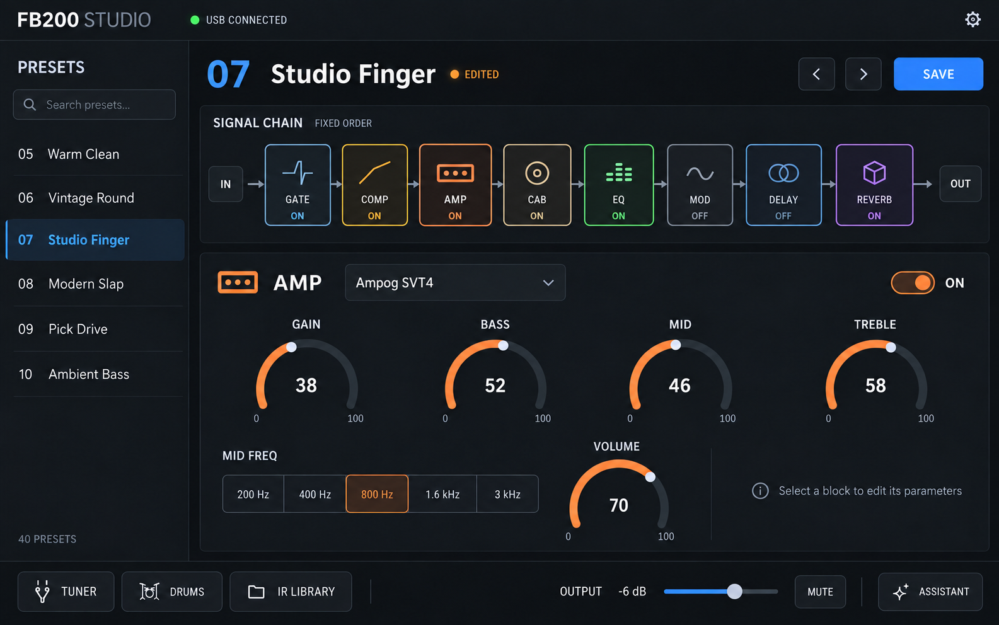

# FB200 Studio UI concept

最新版：[imagegen試作から操作可能なFlutter UIへの反映（0.10.2）](NAM_STUDIO_UX.md)。

2026-10-20に内蔵image_genで生成した初期案です。最初はmainブランチのWeb版を参照しました。その後、NAM統合済みブランチを基にAndroid / Flutter版を改修しています。

実装版の画面と検証記録は [NAM Studio](NAM_STUDIO.md) を参照してください。以下は初期検討案で、NAM版の仕様とは異なります。

## 操作の中心

- 左側に40件のプリセット一覧、上部に現在のプリセットと未保存表示・保存ボタン。
- 上段に固定順の信号経路：IN → GATE → COMP → AMP → CAB → EQ → MOD → DELAY → REVERB → OUT。
- 色・ラベル・ON/OFFでブロックを識別し、選択中ブロックのパラメータを下段に大きく表示。
- AMPのパラメータと選択肢は `src/fb200/params.py` を参照。連続値は0〜100、MID FREQは定義済みの5段階。
- チューナー、ドラム、IRライブラリ、出力・ミュートを下部に集約。アシスタントはボタンから開く構想。

プリセット名、接続状態、値は表示例です。色は補助とし、状態は文字でも判別できる設計とします。Flutter実装時はノブのドラッグ操作、直接数値入力、キーボード操作を提供します。スマートフォンの縦画面レイアウトは別途設計が必要です。

## 参考と生成記録

参考：[Quad Cortex公式マニュアル](https://neuraldsp.com/manual/quad-cortex)の信号経路を中心とするワークフロー。FB200で確認できた機能に合わせ、固定の直列経路として構成しています。

- 最終画像：`fb200-studio-ui-concept-v1.png`
- 初回プロンプト：[`fb200-studio-ui-concept-prompt.txt`](fb200-studio-ui-concept-prompt.txt)
- 重複MODブロックの修正プロンプト：[`fb200-studio-ui-concept-edit-prompt.txt`](fb200-studio-ui-concept-edit-prompt.txt)
- 生成方法：内蔵image_gen。初稿のMOD重複を編集し、最終画像で8ブロックの順序とパラメータ表示を目視確認。
